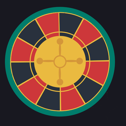

<div align="center">
  

# Ballest Map Roulette

**Let the roulette decide which Hub map you play next.**

A random map selector for **Ballest of Them All**, featuring real Workshop map previews, customizable filters, animated spins, and dramatic audio.

**Version 0.1.5** · Windows / Steam · Requires Ballest Plugin Manager
</div>

> [!IMPORTANT]
> **Known issue: Author-time limits are not reliable in v0.1.5.** Leave the **Min** and **Max author time** boxes empty for normal use. The other roulette features can be used without this filter. See [Known limitations](#known-limitations).

## What does it do?

Map Roulette searches community-created maps from the game's **Hub (Steam Workshop)**, builds a pool of maps matching your filters, then randomly picks one with a five-thumbnail spinning reel.

You can play the winning map immediately, roll again, or enable automatic loading after the reveal.

### Features

- **Random Hub map selection:** Pull from Workshop maps instead of choosing one yourself.
- **Animated roulette:** See five real map thumbnails scroll and stop on a winner.
- **Search and filters:** Search text, include/exclude tags, minimum rating, minimum play count, and maps you haven't finished.
- **Sound:** Adjustable dramatic spin music, spinning clicks, and a winner reveal sound. Quiet music is the default.
- **Flexible play:** Manually open the winner, spin again, or automatically load the winner after a short countdown.
- **Quick access:** Open from the game's main menu, footer, or with **F7**.

> **About author-time filters:** The controls appear in this build, but they cannot reliably filter all Workshop maps by their author-medal time yet. They are experimental, not a dependable way to pick shorter maps.

## Requirements

- **Ballest of Them All** installed through **Steam on Windows**
- **[Ballest Plugin Manager](https://github.com/AnythingGoes-ballest/ballest-plugin-manager#install)** by AnythingGoes, version **0.26.0 or newer**
- An internet connection and working Steam Workshop access to search and open community maps

**Map Roulette is a Plugin Manager plugin, not a UE4SS mod.** You do not need UE4SS for this plugin, and you should not put these files in a `Mods` folder.

## Installation

> [!NOTE]
> **Not yet available in the public plugin browser.** Map Roulette is still in development. The instructions below are how players will install it **once it has been reviewed and added to the [Ballest Plugin Manager](https://github.com/AnythingGoes-ballest/ballest-plugin-manager)**. For testing an unreleased version, see [Manual setup for private testing](docs/DEVELOPMENT.md#manual-setup-for-private-testing).

1. Install **[Ballest Plugin Manager](https://github.com/AnythingGoes-ballest/ballest-plugin-manager#install)** if you don't already have it.
2. Launch **Ballest of Them All**.
3. Click **plugins** in the footer of the main menu.
4. Open the plugin browser and search for **Map Roulette**.
5. Select **Map Roulette** and click **install**.

Once installed, open **map roulette** from the main menu or footer, or press **F7** (some laptops use **Fn + F7**).

**You won't need to download a ZIP, edit game folders, or install UE4SS.** Plugin Manager downloads and checks the files for you.

## How to use it

1. Open **Map Roulette** while you're at the main menu.
2. Choose your search terms and filters, or leave them at their defaults for a broader pool of maps.
3. **Leave both author-time fields blank** in v0.1.5.
4. Click **FIND MAPS** and wait for the Workshop search to finish.
5. Click **SPIN ROULETTE**. The thumbnails will spin and stop on a randomly selected map.
6. On the winner screen, choose:
   - **PLAY THIS MAP** to open the selected map.
   - **SPIN AGAIN** for another random choice from the matching pool.
   - **< FILTERS** to adjust your search.

If you enable **Open the chosen map automatically**, the game starts loading the winner about **6 seconds** after the reveal. You can close the roulette before then to cancel automatic loading.

**STOP SPIN** stops the current animation without confirming a winner. To change your filters, return to the filter screen and click **FIND MAPS** again.

### Filter reference

| Setting | What it does |
| --- | --- |
| **Search** | Finds maps using Workshop title, description, or tag text. |
| **Include tags** | Only includes maps with the tags you enter, separated by commas. |
| **Exclude tags** | Excludes maps with the tags you enter, separated by commas. |
| **Sort** | Chooses the Workshop result order (top, trending, newest, updated, most played, liked, relevance). The roulette still picks randomly among the maps that pass your filters. |
| **Min rating** | Restricts results to your chosen minimum rating (3, 4, or 5 stars). |
| **Min plays** | Requires at least 10, 100, or 1,000 recorded plays. |
| **Only maps I haven't finished** | Excludes maps where the game has a recorded personal completion time for you. |
| **Min / Max author time** | **Experimental — not reliable in this version. Leave blank.** |
| **Open the chosen map automatically** | Loads the selected map after its winner reveal countdown. |
| **Spin music** | Choose Off, Quiet (default), or Normal. |
| **Roulette clicks + reveal** | Turn the spinning clicks and winner sound on or off. |

## Updating

When a new version has been approved and added to Plugin Manager:

1. In Ballest, open **plugins**.
2. Find **Map Roulette** under your installed plugins.
3. Click **update** if an update is available.

Plugin Manager downloads and verifies the new files, replaces the old ones, and preserves your plugin settings. Updates will **not** appear just because a new commit is pushed to GitHub; they must first be added to the Plugin Manager registry.

## Uninstalling

1. In Ballest, open **plugins**.
2. Find **Map Roulette** in the installed plugins list.
3. Click **remove**.

To stop the plugin without uninstalling it, choose **turn off** instead. You don't need to delete any game files yourself.

> **Private test builds:** If you installed the source manually before Map Roulette was listed in Plugin Manager, see [manual-test cleanup](docs/DEVELOPMENT.md#manual-setup-for-private-testing).

## Troubleshooting

<details>
<summary><strong>Map Roulette doesn't appear in the game</strong></summary>

- Confirm that [Ballest Plugin Manager](https://github.com/AnythingGoes-ballest/ballest-plugin-manager#install) is installed and running.
- After public listing, search for **Map Roulette** in Plugin Manager's browser and install it from there.
- If you installed a private test copy manually, follow the [test installation guide](docs/DEVELOPMENT.md#manual-setup-for-private-testing) to check its location, then restart Ballest.
- Open **plugins → console** to check for loading or compilation errors.

</details>

<details>
<summary><strong>Search finds no maps or takes a long time</strong></summary>

- Check that Steam is online and Workshop is accessible.
- Try removing search terms, tags, rating limits, and minimum play counts.
- Leave author-time fields blank.
- If the search reports **more than 10,000 maps**, narrow the query with a title or tags. The plugin won't spin from a partially searched result set.
- Broad searches can take longer because the plugin requests multiple pages of Workshop results.

</details>

<details>
<summary><strong>Thumbnails are blank or maps won't load</strong></summary>

- Give Steam time to load/download image previews. A placeholder can appear while an image is pending.
- Ensure Steam is connected before attempting to open a Workshop map.
- If a map fails to load, return to the roulette and try again or select another map.

</details>

<details>
<summary><strong>I can't hear the roulette music</strong></summary>

- Set **Spin music** to **Quiet** or **Normal**, not Off.
- Make sure the `sounds` folder contains `music_00.wav` through `music_15.wav`, plus `tick.wav` and `reveal.wav`.
- Check the game's audio volume. Closing a spin can leave a very short audio tail, because individual sounds cannot be instantly stopped by the current Plugin Manager audio API.

</details>

**Still having an issue?** Open **plugins → console** in-game. The log is also stored at:

```text
%LOCALAPPDATA%\Ballest\Saved\PluginManager\host.log
```

Include the Map Roulette version, what you were doing, and any relevant error lines when [reporting an issue](https://github.com/YT-skyfall/ballest-map-roulette/issues). Avoid posting private information from unrelated log entries.

## Known limitations

- **Author-time filtering is experimental.** Workshop search results don't currently expose a verified author-medal time for every unplayed map through the plugin API. Strict limits may not behave as expected; leave the fields empty until a fix is verified.
- **Large searches:** Queries exceeding approximately 10,000 Workshop results require narrower filters; the plugin does not intentionally choose from a partial result set.
- **Preview loading:** Workshop map images can take time to appear.
- **Audio stopping:** A short already-playing sound segment may finish after a spin is stopped or the window is closed.

## About the project

Map Roulette is an independent community-made plugin for **Ballest of Them All**, created by **Sky.** It runs through the [AnythingGoes Ballest Plugin Manager](https://github.com/AnythingGoes-ballest/ballest-plugin-manager).

The included dramatic music is a newly synthesized arrangement inspired by *In the Hall of the Mountain King* by Edvard Grieg, rather than a commercial recording.

Source code and development notes are available in this repository; technical work in progress is tracked in [`docs/DEVELOPMENT.md`](docs/DEVELOPMENT.md).

**This is an unofficial community project, not an official Ballest feature.**
